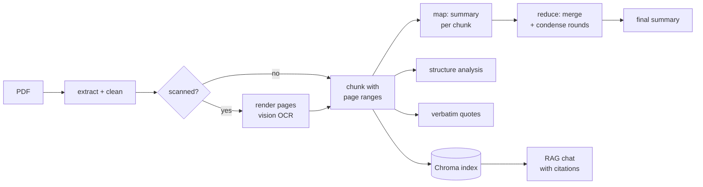

# pdf-reader

An end-to-end PDF summariser built on **LangChain** and **Google Gemini**, with a
local **Streamlit** UI. Upload one or more PDFs, get a summary in the style you
choose, read structure analysis and verbatim key quotes, chat with the document
(RAG, with page citations), and see exactly what each run cost in tokens.

Inspired by [pdfsummarizer-gemini](https://github.com/niti007/pdfsummarizer-gemini),
rebuilt with multi-PDF input, OCR fallback, chat-with-PDF and token accounting.
Built in phases — see [ROADMAP.md](ROADMAP.md).

## Status

| Phase | Scope | State |
|---|---|---|
| 0 | Toolchain, credentials, repo | ✅ complete |
| 1 | Skeleton & config | ✅ complete |
| 2 | PDF ingestion (+ OCR fallback) | ✅ complete |
| 3 | Summarisation core | ✅ complete |
| 4 | Chat with PDF (RAG) | ✅ complete |
| 5 | Streamlit UI | ✅ complete |
| 6 | Tests & CI | ✅ complete |
| 7 | Docs & release | ✅ complete |

## Requirements

- Python 3.12 (3.13/3.14 wheels for some dependencies are still unreliable)
- A Google AI Studio API key ([aistudio.google.com/apikey](https://aistudio.google.com/apikey))

## Setup

```powershell
py -3.12 -m venv .venv
.\.venv\Scripts\Activate.ps1
pip install -r requirements.txt
Copy-Item .env.example .env    # then put your key in .env
```

Everything runs locally. The only network calls are to the Gemini API; the chat
index is stored on disk under `chroma_db/`.

## Run

### Streamlit UI

```powershell
streamlit run app.py
```

Upload one or more PDFs, pick a style, and press **Summarise**. The tabs are:

| Tab | Contents |
|---|---|
| Summary | The merged summary, with Markdown / text / CSV downloads |
| Chat | RAG chat over the document; answers cite `[n] pp.x-y` and refuse when the text does not contain the answer |
| Structure | Document type, logical sections, argument flow, notable elements |
| Quotes | 5–10 verbatim quotes with page references |
| Stats & Cost | Calls, input/output tokens, estimated cost, per-step table, chunk table |

Results are cached in session state keyed on file digest + settings, so switching
tabs or re-running the script never re-bills you. Press **Clear results** in the
sidebar to start fresh.

### CLI

```powershell
# verify the key and model
python cli.py --check

# summarise one PDF
python cli.py data\uploads\demo.pdf --style detailed --analysis --quotes --out summary.md

# force several chunks to exercise map-reduce
python cli.py data\uploads\demo.pdf --chunk-size 300 --chunk-overlap 40 --stats stats.csv

# ask a question about the document (builds a Chroma index)
python cli.py data\uploads\demo.pdf --ask "What is the biggest risk?"
```

Styles: `brief`, `detailed`, `bullet_points`, `executive`. Run `python cli.py -h`
for every flag (`--model`, `--no-ocr`, `--top-k`, `--quiet`, `--log-level`, ...).

## How it works



1. **Extraction** — `pypdf` reads each page, text is NFKC-normalised, hyphenated
   line breaks are repaired, and repeated header/footer lines are stripped.
2. **OCR fallback** — if a page has fewer than ~100 alphanumeric characters on
   average, pages are rasterised with `pypdfium2` and transcribed by the vision
   model (capped by `OCR_MAX_PAGES`).
3. **Chunking** — token-bounded (`tiktoken` as a proxy for Gemini's tokeniser)
   with overlap, and every chunk remembers the page range it came from.
4. **Map-reduce** — one summary per chunk, then a merge. If the partial
   summaries exceed ~8k tokens they are condensed in rounds first, so the merge
   always fits the context window.
5. **Auxiliary steps** — structure analysis and quotes read the page-labelled
   source chunks (not the merged summary), which keeps quotes verbatim.
6. **RAG** — chunks are embedded with `gemini-embedding-001` into a Chroma
   collection named after the document content, so re-indexing reuses vectors
   and different files never pollute results. Answers cite passages; if nothing
   clears the relevance threshold the app refuses without spending a model call.

## Configuration

Settings come from `.env` (or real environment variables) and are validated by
pydantic. See `.env.example`.

| Variable | Default | Notes |
|---|---|---|
| `GEMINI_API_KEY` | — | required |
| `GEMINI_MODEL` | `gemini-3.1-flash-lite` | any model your key can see |
| `GEMINI_EMBEDDING_MODEL` | `gemini-embedding-001` | used for the chat index |
| `CHUNK_SIZE` / `CHUNK_OVERLAP` | `4000` / `200` | tokens |
| `TEMPERATURE` | `0.2` | |
| `MAX_OUTPUT_TOKENS` | `2048` | |
| `MAX_RETRIES` | `4` | exponential backoff on 429/5xx |
| `OCR_ENABLED` | `true` | |
| `OCR_MAX_PAGES` | `20` | cost guard for long scans |
| `OCR_DPI` | `200` | raster resolution |
| `DATA_DIR` / `CHROMA_DIR` | `data/uploads`, `chroma_db` | |

## Cost notes

Token counts are read from the provider's `usage_metadata`, so they are exact.
Dollar estimates come from `config.PRICING` (USD per million tokens) and are
reported as **unknown** for any model without an entry — the app never invents a
price. Add a model by appending one line:

```python
PRICING["gemini-3.1-flash-lite"] = Price(input_per_mtok=0.0, output_per_mtok=0.0)
```

Measured on the bundled 6-page demo PDF (2 chunks, `detailed` + analysis + quotes):

| Step | Calls | Input | Output |
|---|---|---|---|
| map | 2 | 674 | 415 |
| combine | 1 | 574 | 373 |
| analysis | 1 | 594 | 339 |
| quotes | 1 | 582 | 297 |
| **total** | **5** | **2,424** | **1,424** |

Embedding calls for the chat index are **not** counted in the ledger (only
generation calls are). A refused question costs zero tokens. Raising chunk size
reduces the number of map calls but increases per-call input; the demo runs at
about 3.8k tokens end to end.

## Tests

```powershell
pip install -r requirements-dev.txt
ruff check .
ruff format --check .
pytest              # 47 tests, no API calls
pytest -m live      # 2 tests that call Gemini for real (costs tokens)
pre-commit install  # optional: lint + format on every commit
```

CI runs the same lint and test commands on Python 3.12 via GitHub Actions and
needs no API key. Live tests are marked `live` and deselected by default.

## Layout

```
app.py            Streamlit UI (tabs, uploads, downloads)
cli.py            Command-line entry point
config.py         Settings, model + pricing tables
errors.py         Typed exceptions
logging_setup.py  Logging + key masking
pdf_processor.py  Extraction, cleaning, chunking, OCR rendering
pipeline.py       Orchestration: file -> pages -> chunks -> summary
prompts.py        All ChatPromptTemplate definitions
rag.py            Gemini embeddings, Chroma store, grounded chat
summarizer.py     Gemini calls: chunk summaries, combine, analysis, quotes, RAG
utils.py          Token accounting, cost ledger, formatting helpers
tests/            pytest suite
```

## Troubleshooting

| Symptom | Fix |
|---|---|
| `configuration error ... GEMINI_API_KEY` | create `.env` from `.env.example` and restart |
| `model '...' is not available to this key` (404) | set `GEMINI_MODEL` to one from `client.models.list()` |
| `still failing after N attempts` (429) | you hit the free-tier rate limit; wait, lower `CHUNK_SIZE`, or raise `MAX_RETRIES` |
| `has no extractable text (scanned PDF?)` | it is a scan and OCR is off — enable `OCR_ENABLED` |
| OCR output is garbage | raise `OCR_DPI` (300 is usually enough for 10–12pt text) |
| First run is slow / tiktoken warning | the BPE file is downloaded once; offline it falls back to a 4-chars-per-token estimate |
| Chat answers look stale | delete `chroma_db/` and ask again; collections are content-addressed |
| `?` instead of `·` in a Windows console | the console is cp1252; the CLI already uses ASCII separators |

## Limitations

- OCR is unit-tested with a stubbed vision model but has not been validated on a
  real scanned document.
- Only the first `OCR_MAX_PAGES` pages of a scan are transcribed.
- Embedding tokens are not included in the cost ledger.
- The app is single-user and local; there is no auth, queue or cloud storage.

## Security

`.env` is git-ignored and must never be committed. Only `.env.example` is
tracked. API keys are masked in logs and in the UI (`AQ.A...KA (53 chars)`).
